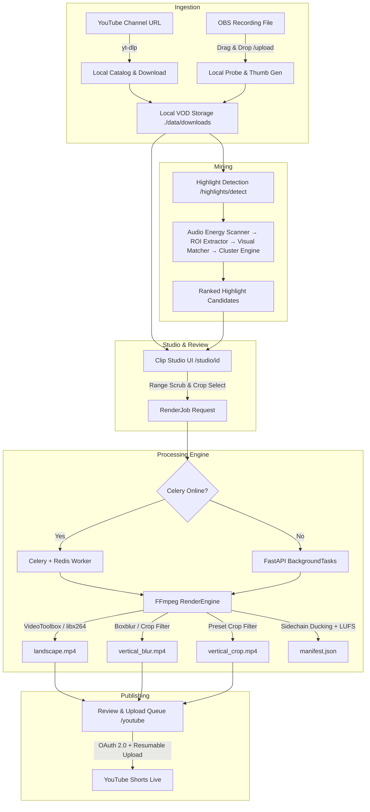

# 🧭 BackseatCaster — Architecture

> Companion deep dives: [docs/rendering.md](docs/rendering.md), [docs/audio-pipeline.md](docs/audio-pipeline.md), [docs/highlight-mining.md](docs/highlight-mining.md), [docs/background-tasks.md](docs/background-tasks.md), [docs/ingestion.md](docs/ingestion.md), [docs/publishing.md](docs/publishing.md).
> For key design decisions and their rationale, see [docs/adr/](docs/adr/).

BackseatCaster is a local-first pipeline: **Ingest → Review → Render → Publish**, with everything under `./data` on disk and no cloud dependency required for the core loop.

---

## 1. Operational Architecture (Built)



---

## 2. Backend Layers

The backend follows a strict **layered service-oriented architecture** (see [ADR 0001](docs/adr/0001-service-oriented-architecture.md)):

```
HTTP  ─>  routers/          thin controllers: parse, delegate, map exceptions to HTTP codes
              │
              ▼
          services/         business logic: VideoService, RenderService, YouTubeUploaderService,
              │             YtdlpService, RedisService, AutoStageService, AutoPipelineService,
              │             LLMMetadataService, YouTubeQuotaService, highlight pipeline modules
              ▼
          models/           SQLAlchemy ORM: Video, RenderJob, HighlightRun, HighlightCandidate
              │
              ▼
          database.py       SQLite engine, SessionLocal, get_db, get_task_db_session
```

Supporting subsystems live outside the request path:

- **`app/rendering/`** — the FFmpeg render engine (`engine.py` orchestration, `filters.py` video graphs, `audio.py` audio graphs, `probe.py` ffprobe, `validator.py`, `manifest.py`, `cli.py` standalone renderer).
- **`app/worker/`** — Celery app, task registry (re-exported from services for backwards compatibility), and broker health check (`is_celery_broker_online`).
- **`app/core/`** — `BaseResponse[T]` envelope + exception handlers, `CorrelationIdMiddleware`, colored logging, dependency container.

### Request lifecycle

1. **Lifespan** (`app/main.py`): initialize dependency container, create runtime directories (`./data/downloads`, `./data/renders`, `./data/highlights`).
2. **Middleware:** `CorrelationIdMiddleware` assigns `X-Correlation-ID` to every request; CORS is configured from `settings.CORS_ORIGINS`.
3. **Router:** validates input with Pydantic schemas, delegates to a service.
4. **Service:** performs DB work and/or dispatches background work.
5. **Background dispatch (the fallback pattern):**
   ```python
   if is_celery_broker_online():
       task = my_celery_task.delay(*args)   # Celery + Redis
   else:
       background_tasks.add_task(my_task, *args)  # FastAPI BackgroundTasks
   ```
6. **Response:** every endpoint (except file streams/redirects) wraps its payload in `BaseResponse[T]` (see [docs/response-envelope.md](docs/response-envelope.md)).

---

## 3. Data Flow & Storage

All persistent artifacts live under `./data` (gitignored):

| Path | Content | Written by |
|---|---|---|
| `data/backseatcaster.db` | SQLite database | SQLAlchemy / Alembic |
| `data/downloads/` | VOD files, thumbnails (`<video_id>_thumb.jpg`) | yt-dlp, OBS upload service |
| `data/renders/<clip_id>/` | `landscape.mp4`, `vertical_blur.mp4`, `vertical_crop.mp4`, `manifest.json` | RenderEngine |
| `data/highlights/` | Run artifacts, candidate thumbnails, detection payloads | HighlightService |
| `data/client_secrets.json` | Google OAuth client config | User-provided |
| `data/youtube_token.json` | OAuth token store | YouTubeUploaderService |

- Datetimes are always timezone-aware (`datetime.now(UTC)`).
- The SQLite engine sets `connect_args={"check_same_thread": False}`.
- Schema changes require an Alembic migration (`uv run alembic revision --autogenerate -m "..."`).

---

## 4. Background Execution Model

- Heavy work (downloads, renders, highlight detection, uploads) never runs inside the request.
- **Celery + Redis** is preferred in Docker/production; **FastAPI `BackgroundTasks`** is the zero-config fallback for lightweight local development.
- Background jobs obtain DB sessions via `get_task_db_session()` (respects test overrides) and always close sessions in `finally` blocks.
- Job state transitions (`pending → processing → completed/failed`) are persisted on the `RenderJob` / `HighlightRun` models so the UI can poll status endpoints.
- **Maintenance sweep (optional):** Celery beat can run `auto_pipeline_task` every `AUTO_PIPELINE_INTERVAL_MINUTES` to purge render folders for already-uploaded clips and batch-stage the next `AUTO_STAGE_TOP_N` highlights per downloaded video. It runs on demand via `POST /api/v1/renders/auto-pipeline`; cleanup never deletes `RenderJob` rows.

Details and failure modes: [docs/background-tasks.md](docs/background-tasks.md).

---

## 5. Frontend Architecture (`ui/`)

- **Next.js 16 App Router** pages: `/` (dashboard), `/channel`, `/videos/[id]`, `/studio` + `/studio/[id]` (clip studio), `/renders`, `/staging` (auto-staged review queue), `/youtube`.
- **`src/lib/api.ts`** is the single API client; it unwraps the `BaseResponse` envelope (`response.response`) and centralizes error handling.
- **`src/types/video.ts`** mirrors the backend Pydantic schemas.
- Components: `ClipStudioModal`, `HighlightCandidatesDrawer`, `RenderJobRow`, `RenderCard`, `AutoStagePanel`, `UploadQueueModal`, `OBSUploadDropzone`, `VideoCard`, `StatsBar`, `Navbar`, pagination and stats widgets.
- The UI is a stateless client: all state of record lives in the backend catalog (SQLite) and the filesystem.

---

## 6. Hardware Acceleration

The render engine probes available FFmpeg encoders (`detect_available_encoders()`) and selects:

- **macOS / Apple Silicon:** `h264_videotoolbox` (bitrate presets per quality tier).
- **Linux / Docker:** `libx264` with CRF presets.

Never hardcode encoder flags — see [docs/rendering.md](docs/rendering.md) and [ADR 0005](docs/adr/0005-automatic-encoder-selection.md).
