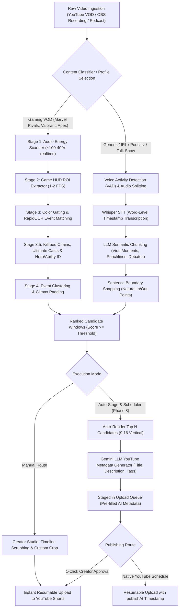

# 🗺️ BackseatCaster — Roadmap

> Status legend: **Completed** ✅ · **In Progress / Partial** 🚧 · **Planned** 📋

[](https://opensource.org/licenses/MIT)
[](https://www.python.org/downloads/)
[](https://nextjs.org/)
[]()
[](https://ffmpeg.org/)

BackseatCaster is a **local-first AI video editing and publishing pipeline** designed to transform raw gameplay recordings (VODs) into high-impact gaming clips, highlights, and YouTube Shorts.

## 0. Product Overview & Current State

**Current Product Reality:** The foundational manual editing, rendering, and publishing stack is **100% built, tested, and operational**:
- **Local Rendering Engine:** Apple Silicon `h264_videotoolbox` / `libx264` rendering to 16:9 Landscape Master and 9:16 Vertical formats (Full Blur, Third-Person Wide Crop, Direct Center Crop) with Lanczos scaling.
- **Audio Pipeline:** Sidechain compression mixing voiceover narration with ducked gameplay audio, peak limiting, and EBU R128 (-14 LUFS) loudness normalization.
- **Web Studio & Review UI:** Next.js 16 interface with timeline video player, dual-handle range scrubbing, crop guide overlays, live comparison tabs, and job status polling.
- **Ingestion Suite:** Dual-mode ingestion via YouTube `yt-dlp` channel scraping & download, plus drag-and-drop OBS local video upload with instant probing & thumbnail generation.
- **YouTube Ingestion & Publishing:** Google OAuth 2.0 authentication, upload staging queue, and direct resumable publishing to YouTube Shorts via YouTube Data API v3.
- **Background Worker Engine:** Celery + Redis with automatic fallback to FastAPI `BackgroundTasks`.

---

## 1. Executive Status Overview

| Phase | Category | Scope / Deliverable | Status |
|---|---|---|---|
| **Phase 1** | Engine | **Local Video Rendering Engine:** 16:9 master, 9:16 blur & crop presets, ducking, hardware acceleration, CLI, API | ✅ Completed |
| **Infra** | Core | **Async Worker System:** Celery + Redis with automatic fallback to FastAPI `BackgroundTasks`, DB lifecycle | ✅ Completed |
| **Phase 2 (Ingest)** | Ingestion | **Video Ingestion & Local OBS Import:** YouTube scraping/download (`yt-dlp`), direct OBS drag-and-drop, probe & thumbnails | ✅ Completed |
| **Phase 2 (Mining)** | Mining | **Candidate Highlight Mining:** Audio energy scanning, HUD ROI extraction, color gating, OCR matching, clustering, UI drawer | ✅ Completed |
| **Phase 2.5** | Accuracy & Perf | **Anti-False-Positive Hardening & Speed Optimization:** Upper-banner ROI alignment, scoreboard rejection, persistence scoring | ✅ Completed |
| **Shorts+ Audio** | Engine | **EBU R128 Audio Normalization:** Dual-chain `loudnorm` filter targeting -14 LUFS standard for YouTube Shorts | ✅ Completed |
| **Phase 6** | UI / Studio | **Creator Studio & Review Interface:** Web studio (`/studio/[id]`), timeline scrubbing, crop overlays, catalog, bulk delete | ✅ Completed |
| **Phase 7** | Publishing | **YouTube Ingestion & Publishing:** OAuth 2.0 PKCE flow, metadata staging, resumable YouTube Shorts Data API v3 upload | ✅ Completed |
| **Phase 8** | Automation | **Auto-Stage & Scheduler Pipeline:** Auto-render top N highlights, LLM-generated title/tags, native YouTube `publishAt`, 1-click publish, batched maintenance + storage cleanup | ✅ Completed |
| **Phase 8.5** | Highlights & Workflow | **Highlight Lifecycle Separation & Batch Staging Pipeline:** Separate uploaded, rendered, and left candidates, multi-select & Top-N-Left batch processing | ✅ Completed |
| **Tier 0/1** | Onboarding | **Installability & First-Run Experience:** Preflight checks, `.env.example`, setup wizard, in-app settings, guided YouTube OAuth, 60-second demo project | ✅ Completed |
| **Phase 10** | Zero-Input | **Zero-Input Ingest:** OBS watch folder + auto-mine on ingest chaining download/upload straight into mining, auto-staging and `publishAt` | ✅ Completed |
| **Tier 3** | Branding | **Channel Brand Consistency:** DB-backed channel profile with watermark overlay, framing/quality defaults, title template, pinned hashtags, privacy and upload slots | ✅ Completed |
| **Phase 9** | Multi-Genre | **Generic Video & Speech Mining (STT):** Dialogue-driven highlight discovery via Whisper STT + LLM semantic chunking & sentence snapping | 📋 Planned |
| **Phase 3** | Vision & OCR | **HUD/OCR & Deep Visual Event Extraction:** Killfeed sequence chains, ultimate charge meters, ability identification | ✅ Completed |
| **Phase 4** | Multimodal AI | **Gemini Event Verification:** Multimodal clip verification, structured highlight event schema, temporal grounding | 📋 Planned |
| **Phase 5** | AI Audio | **AI Commentary & TTS Generation:** Gemini play-by-play casting script generation, automated TTS narration, hype sync | 🚧 Partial Base |
| **Shorts+ Captions** | Engagement | **Dynamic Animated Captions (Subtitles):** Whisper word-level transcription, animated karaoke subtitles burned into 9:16 | 📋 Planned |
| **Shorts+ Layout** | Layouts | **Split-Screen Facecam + Gameplay:** Custom dual-crop filter (top webcam, bottom gameplay) for streamer VODs | 📋 Planned |

---

## 2. Detailed Phase Breakdown & Audit

### Phase 1: Local Video Rendering Engine
*High-performance local rendering powered by FFmpeg with Apple Silicon VideoToolbox acceleration.*

- ✅ **16:9 Landscape Master Export:** Lanczos scaling and letterbox/pillarbox padding for arbitrary aspect ratio sources (`build_landscape_filter` in [`app/rendering/filters.py`](file:///Users/christopherpaul/projects/backseat-caster/app/rendering/filters.py)).
- ✅ **9:16 Vertical Blur Composition:** Split background with 1080x1920 heavy boxblur padding (`blur_sigma: 25`) and centered 1080-width crisp foreground (`build_vertical_blur_filter` in [`app/rendering/filters.py`](file:///Users/christopherpaul/projects/backseat-caster/app/rendering/filters.py)).
- ✅ **9:16 Vertical Crop Composition & Presets:**
  - `third_person` preset: 33.33% total blur padding (~16.66% top / bottom) providing a 50% wider hero framing ideal for third-person shooters.
  - `cinematic` preset: 25.0% total blur padding (~12.5% top / bottom).
  - `direct_crop` preset: 0.0% blur (100% full-height center crop).
  - `custom` padding parameter support (0.0 to 0.6) (`build_vertical_crop_filter` in [`app/rendering/filters.py`](file:///Users/christopherpaul/projects/backseat-caster/app/rendering/filters.py)).
- ✅ **Hardware Acceleration & Encoder Fallback:** Auto-detection of macOS `h264_videotoolbox` with fallback to `libx264` (`detect_available_encoders()` and `select_encoder()` in [`app/rendering/engine.py`](file:///Users/christopherpaul/projects/backseat-caster/app/rendering/engine.py)).
- ✅ **Quality Presets:** Configurable bitrate and CRF presets (`high`: 5M/7M, `compact`: 3.5M/5M, `archive`: 20M/25M) in [`app/rendering/config.py`](file:///Users/christopherpaul/projects/backseat-caster/app/rendering/config.py).
- ✅ **Audio Ducking Engine:** Sidechain compression ducking game audio (default 30% gain) during voiceover presence, with peak limiting (`alimiter`) to prevent clipping (`build_audio_filter_graph` in [`app/rendering/audio.py`](file:///Users/christopherpaul/projects/backseat-caster/app/rendering/audio.py)).
- ✅ **Shorts+ Audio Loudness Normalization:** Integrated EBU R128 (`loudnorm`) targeting -14.0 LUFS, -1.5 dBTP True Peak, 11.0 LU LRA for YouTube Shorts compliance on both unducked and ducked tracks.
- ✅ **Media Probing & Parameter Validation:** `ffprobe` stream metadata inspection in [`app/rendering/probe.py`](file:///Users/christopherpaul/projects/backseat-caster/app/rendering/probe.py) and input validation in [`app/rendering/validator.py`](file:///Users/christopherpaul/projects/backseat-caster/app/rendering/validator.py).
- ✅ **Standardized Manifest Output:** Multi-format output packaging and `manifest.json` generation in [`app/rendering/manifest.py`](file:///Users/christopherpaul/projects/backseat-caster/app/rendering/manifest.py).
- ✅ **CLI & REST API:** Standalone CLI tool in [`app/rendering/cli.py`](file:///Users/christopherpaul/projects/backseat-caster/app/rendering/cli.py) and full REST controller suite in [`app/routers/renders.py`](file:///Users/christopherpaul/projects/backseat-caster/app/routers/renders.py).

---

### Infrastructure: Async Worker & Resiliency System
*Reliable background task dispatching with graceful local degradation.*

- ✅ **Celery Worker Configuration:** Celery instance with JSON serialization, solo worker pool, UTC timezone handling in [`app/worker/celery_app.py`](file:///Users/christopherpaul/projects/backseat-caster/app/worker/celery_app.py).
- ✅ **Zero-Configuration Fallback:** Active broker and responsive worker ping check (`is_celery_broker_online()` in [`app/worker/helpers.py`](file:///Users/christopherpaul/projects/backseat-caster/app/worker/helpers.py)); automatically switches to FastAPI `BackgroundTasks` when Redis or workers are offline.
- ✅ **Background Database Session Management:** Dedicated `get_task_db_session()` handling request-independent database lifecycles and test suite dependency overrides.
- ✅ **Task Retry & Failure Handling:** Automatic retry policies for background jobs and manual retry endpoints for failed render jobs (`POST /api/v1/renders/jobs/{job_id}/retry`).

---

### Phase 2: Ingestion & Local OBS Import
*Flexible ingest for both remote streaming links and local recording workflows.*

- ✅ **YouTube Channel & VOD Ingestion:** Metadata scraping and async video downloading via `yt-dlp` with progress hooks in [`app/services/youtube.py`](file:///Users/christopherpaul/projects/backseat-caster/app/services/youtube.py) and [`app/services/videos.py`](file:///Users/christopherpaul/projects/backseat-caster/app/services/videos.py).
- ✅ **OBS / Local File Direct Upload:** Multipart upload endpoint (`POST /api/v1/videos/upload`) supporting `.mp4`, `.mkv`, `.mov`, `.webm`, `.flv`, `.ts`, `.m4v`.
- ✅ **Instant Probing & Thumbnail Generation:** Immediate ffprobe metadata extraction and thumbnail frame capture at 1s seek.
- ✅ **Frontend Drag-and-Drop Dropzone:** Animated OBS dropzone with upload progress bar, custom titles, and instant catalog refresh in [`ui/src/components/OBSUploadDropzone.tsx`](file:///Users/christopherpaul/projects/backseat-caster/ui/src/components/OBSUploadDropzone.tsx).

---

### Phase 2 & 2.5: Highlight Mining & Anti-False-Positive Hardening
*High-speed local candidate detection combining audio energy and targeted HUD OCR.*

- ✅ **Stage 1 (Audio Excitement Scanner):** FFmpeg `ebur128`/RMS scanning bucketed into 0.5s windows at ~100-400x realtime; top-percentile energy thresholding prunes dead air and loading screens ([`app/services/highlight/audio_scanner.py`](file:///Users/christopherpaul/projects/backseat-caster/app/services/highlight/audio_scanner.py)).
- ✅ **Stage 2 (HUD ROI Extractor):** Targeted in-memory pipe extraction at 1-2 FPS without decoding full video; multi-resolution scaling support (720p, 1080p, 1440p, 4K, 21:9 Ultrawide) in [`app/services/highlight/roi_extractor.py`](file:///Users/christopherpaul/projects/backseat-caster/app/services/highlight/roi_extractor.py).
- ✅ **Stage 3 (Visual Color Gating & OCR Matching):** Fast HSV color thresholding (<1ms) for Marvel Rivals Gold and Red accents before OCR; RapidOCR event classification (`team_wipe`, `hexa_ko`, `penta_ko`, `quad_ko`, `shutdown`, `kill_streak`, `triple_ko`, `double_ko`, `objective_clutch`, `single_ko`) in [`app/services/highlight/visual_matcher.py`](file:///Users/christopherpaul/projects/backseat-caster/app/services/highlight/visual_matcher.py).
- ✅ **Anti-False-Positive Hardening:**
  - Tab scoreboard & stats menu rejection (`NEGATIVE_SCREEN_PATTERN` rejecting damage/healing stats overlays).
  - Upper-banner ROI alignment (`center_ko`, `right_streak`, `objective_banner`).
  - Multi-frame temporal persistence scoring (1.5s window corroboration).
- ✅ **Stage 4 (Clustering & Padding):** Agglomerative clustering of overlapping / adjacent events; dynamic cinematic padding to 15-45s duration; peak climax thumbnail extraction ([`app/services/highlight/cluster_engine.py`](file:///Users/christopherpaul/projects/backseat-caster/app/services/highlight/cluster_engine.py)).
- ✅ **Stage 5 (Mining API & UI Drawer):** Highlight REST API endpoints (`/api/v1/videos/{video_id}/highlights`) and slide-out candidate drawer with 1-click timeline apply in [`ui/src/components/HighlightCandidatesDrawer.tsx`](file:///Users/christopherpaul/projects/backseat-caster/ui/src/components/HighlightCandidatesDrawer.tsx).

---

### Phase 6: Creator Studio & Review Interface
*Full web-based studio giving creators precision control over crops and review.*

- ✅ **Web Studio Page (`/studio/[id]`):** Dedicated studio workspace with timeline scrubbing, in/out range handles, playhead controls, and live video previews in [`ui/src/app/studio/[id]/page.tsx`](file:///Users/christopherpaul/projects/backseat-caster/ui/src/app/studio/[id]/page.tsx).
- ✅ **Interactive Crop Overlays:** Aspect ratio and crop frame overlays for 16:9, 9:16 Vertical Blur, and configurable 9:16 Vertical Crop in [`ui/src/components/ClipStudioModal.tsx`](file:///Users/christopherpaul/projects/backseat-caster/ui/src/components/ClipStudioModal.tsx).
- ✅ **Comparison Player:** Synchronized multi-video playback coordinator for side-by-side format review in [`ui/src/components/MediaPlaybackCoordinator.tsx`](file:///Users/christopherpaul/projects/backseat-caster/ui/src/components/MediaPlaybackCoordinator.tsx).
- ✅ **Render Catalog (`/renders`):** Dual-view catalog (Gallery grid vs Jobs queue), status filtering, job retry actions, and manifest inspection modal in [`ui/src/app/renders/page.tsx`](file:///Users/christopherpaul/projects/backseat-caster/ui/src/app/renders/page.tsx).
- ✅ **Bulk Delete & Staging Actions:** Bulk selection, batch job cancellation, multi-render deletion with disk cleanup (`POST /api/v1/renders/bulk-delete`).

---

### Phase 7: YouTube Publishing
*Seamless staging and publishing of rendered clips to YouTube Shorts.*

- ✅ **Google OAuth 2.0 PKCE Flow:** Authorization URL generation with PKCE challenge, code exchange, token persistence, and channel info retrieval in [`app/services/youtube_uploader.py`](file:///Users/christopherpaul/projects/backseat-caster/app/services/youtube_uploader.py).
- ✅ **Resumable Upload Engine:** Resumable chunked upload protocol using Google API Client Library with exponential backoff and progress tracking.
- ✅ **Automatic Shorts Detection & Tagging:** Dynamic `#Shorts` tagging in title and description for vertical clips under 60 seconds; automatic category and gaming tags.
- ✅ **Dynamic Metadata Staging:** Centralized metadata generator formatting source links, VOD timestamp references, and commentary attribution in [`app/services/upload_metadata.py`](file:///Users/christopherpaul/projects/backseat-caster/app/services/upload_metadata.py).
- ✅ **Upload Queue Modal & Batch Publishing:** Staging drawer and batch publish modal with editable titles, descriptions, tags, and privacy settings in [`ui/src/components/UploadQueueModal.tsx`](file:///Users/christopherpaul/projects/backseat-caster/ui/src/components/UploadQueueModal.tsx).

---

### Phase 8: Autonomous Pipeline & Scheduler (Auto-Stage, LLM Metadata, publishAt)
*Zero-touch background pipeline from highlight creation to scheduled YouTube Shorts publication.*

- ✅ **Auto-Render Top N Candidates:** Parameterized trigger in highlight detection (`auto_render_top_n: int`, `min_score: float`, `clipping_mode: str`) or the global `AUTO_STAGE_*` settings; enqueues vertical FFmpeg render jobs for the top-scoring candidates as soon as clustering completes, skipping candidates that are already staged ([`app/services/auto_stage.py`](file:///Users/christopherpaul/projects/backseat-caster/app/services/auto_stage.py)).
- ✅ **LLM Metadata Generator Service (Gemini):** Structured output via `google-genai` producing punchy YouTube Shorts titles, descriptions and hashtags conditioned on detected OCR events, hero, multi-kill chain, ultimate payoff and game phase ([`app/services/llm_metadata.py`](file:///Users/christopherpaul/projects/backseat-caster/app/services/llm_metadata.py)). Degrades to the deterministic [`app/services/upload_metadata.py`](file:///Users/christopherpaul/projects/backseat-caster/app/services/upload_metadata.py) generator when the API key is missing, the SDK is unavailable, or the model returns unusable copy; every staged clip records its `metadata_source`.
- ✅ **Native YouTube `publishAt` Scheduling:** Uploads as private with `status.publishAt` so YouTube's infrastructure handles release (no local uptime requirement), with staggered slots (`AUTO_STAGE_FIRST_SLOT_HOURS`, `AUTO_STAGE_INTERVAL_HOURS`) and per-clip rescheduling via `POST /api/v1/youtube/staging/{clip_id}/schedule`.
- ✅ **YouTube API Quota Safeguards:** Per-quota-day unit accounting (10,000 units/day, 1,600 per upload) in [`app/services/youtube_quota.py`](file:///Users/christopherpaul/projects/backseat-caster/app/services/youtube_quota.py) with midnight-Pacific resets, advisory usage tracking (uploads are never blocked locally; YouTube's `quotaExceeded` is surfaced), a pre-dispatch warning in the UI, and a quota bar in the renders UI.
- ✅ **UI 1-Click Staging Notification & Review Drawer:** *"🔥 Highlights Auto-Staged"* banner with quota bar on `/renders`, plus a review drawer offering per-clip schedule editing and 1-click "Publish Now" ([`ui/src/components/AutoStagePanel.tsx`](file:///Users/christopherpaul/projects/backseat-caster/ui/src/components/AutoStagePanel.tsx)).
- ✅ **Automated Maintenance Pipeline:** Uploaded render folders are purged from disk while `RenderJob` upload history is retained, and every downloaded video's next `AUTO_STAGE_TOP_N` highlights are staged in batches so repeated sweeps keep consuming the next-best candidates ([`app/services/auto_pipeline.py`](file:///Users/christopherpaul/projects/backseat-caster/app/services/auto_pipeline.py)). Available on demand via `POST /api/v1/renders/cleanup-uploaded` and `POST /api/v1/renders/auto-pipeline`, or scheduled through Celery beat with `AUTO_PIPELINE_INTERVAL_MINUTES`. Optional source-VOD cleanup (`AUTO_CLEANUP_VOD`) only runs when every completed render for the video is uploaded.

---

### Phase 8.5: Highlight Lifecycle State Management & Batch Staging Pipeline
*End-to-end candidate lifecycle state tracking (Uploaded vs Rendered vs Left) and interactive batch queuing for high-volume mined highlights.*

- ✅ **Highlight Lifecycle Status Engine (Backend):**
  - Relational aggregation linking `HighlightCandidate` records with `RenderJob` execution history (`status`, `youtube_upload_status`, `youtube_video_id`, `youtube_upload_url`, `scheduled_publish_at`).
  - Derived `processing_status` state taxonomy on candidates: `uploaded` (published to YouTube Shorts), `staged` (queued with `publishAt` slot), `rendered` (rendered locally, not yet uploaded), `rendering` (active in worker), `unprocessed` / `left` (available candidate), or `failed`.
  - Enriched `HighlightCandidateResponse` schema returning candidate status, render job links, YouTube upload URLs, and aggregate category counts (`total`, `unprocessed`, `rendered`, `uploaded`, `top_rated_left`).
- ✅ **Highlight Lifecycle Separation & Filtering (Frontend UI):**
  - Dedicated lifecycle tabs in [`HighlightCandidatesDrawer.tsx`](file:///Users/christopherpaul/projects/backseat-caster/ui/src/components/HighlightCandidatesDrawer.tsx): **All**, **Left / Unprocessed**, **Rendered**, and **Uploaded**.
  - Compound filters combining lifecycle state with rating tiers (e.g. *"Top Rated Left"*) and game events (*Team Wipes*, *Multi-KOs*, *Clutches*).
  - Visual status badges on candidate cards with direct clickable YouTube Shorts links for published clips, and duplicate render prevention.
- ✅ **Batch Selection & "Select Top N Left" Queueing:**
  - Multi-candidate selection with individual card checkboxes and "Select All Visible" toggle.
  - Quick-selection presets (`Top 3 Left`, `Top 5 Left`, `Top 6 Left`, `Top 10 Left`) plus arbitrary selection.
  - Default vertical framing preset permanently set to `third_person` (hero-centered wide crop with subtle blur margins).
  - Floating batch action toolbar with framing preset selector (`third_person` default, `direct_crop`, `vertical_blur`, `cinematic`) and native YouTube scheduling toggle.
  - Dedicated endpoint `POST /api/v1/videos/{video_id}/highlights/batch-stage` accepting explicit `candidate_ids`, dispatching FFmpeg rendering, copy generation, and native `publishAt` slot assignment.
- ✅ **Same-Day Slot Catchup Algorithm (publishAt Scheduling):**
  - If a daily slot is missed because generation time has passed the slot time (e.g., 08:00 and 12:30 missed when generating in the afternoon), missed items are scheduled at the immediate next available slot spaced by safe 3-minute intervals so all videos are published on the **same day** instead of waiting for a new day.
- ✅ **Enhanced Deterministic Copy Generation:**
  - Rich deterministic copy without hitting an LLM: integrates chosen hero into title templates, adds gameplay context and timing to descriptions, and extracts candidate/game tags into clean YouTube tags.
- ✅ **Safe Deletion & Upload Audit Preservation:**
  - Cleaning or bulk-deleting renders now frees up local disk space while permanently preserving database records and YouTube links for published clips.

---

### Phase 10: Zero-Input Ingest (Watch Folder + Auto-Mine)
*The "least input" north star: record, walk away, come back to staged Shorts.*

- ✅ **Auto-Mine On Ingest (`AUTO_MINE_ON_INGEST`):** a completed YouTube download or OBS upload automatically dispatches the existing detection pipeline, which auto-stages the top candidates (Phase 8) with metadata and native `publishAt` slots. The chain reuses `HighlightService.detect_highlights`, so run records, status transitions, detector resolution and the Celery/`BackgroundTasks` fallback stay in one place (`app/services/auto_mine.py`).
  - `AUTO_MINE_GAME` pins a detector profile; when unset the registry auto-detects from video metadata instead of silently forcing a generic profile.
  - `AUTO_MINE_AUTO_RENDER_TOP_N` overrides how many candidates to auto-render; unset falls back to `AUTO_STAGE_TOP_N` when `AUTO_STAGE_ENABLED` is true, otherwise mining only.
  - Idempotent and non-fatal: videos already `completed`/`scanning` are skipped, and a mining failure never fails the download or upload that succeeded.
- ✅ **OBS Watch Folder (`WATCH_DIR`):** point the app at the folder OBS writes recordings into and new files are ingested automatically — copied (or moved with `WATCH_DELETE_AFTER_INGEST`) into `data/downloads`, probed, thumbnailed, catalogued, then auto-mined (`app/services/watch_folder.py`).
  - **Stability gate:** a file is only ingested once its mtime is older than `WATCH_STABILITY_SECONDS`, so a recording OBS is still writing is never truncated into a corrupt catalog entry.
  - **Dedupe ledger:** a `watch_ingests` table records the `size:mtime` fingerprint per source path, so repeated polls skip already-ingested takes but still pick up a filename OBS overwrites with a new recording.
  - **Scheduling:** Celery beat polling via `WATCH_POLL_INTERVAL_MINUTES`, or on demand with `POST /api/v1/videos/watch/scan` (plus `GET /api/v1/videos/watch/status`).
- ✅ **In-App Configuration:** auto-mine toggle, watch folder path, poll interval, and move-vs-copy are all editable from the setup wizard and persist to `data/settings.json` — no `.env` editing required. The setup diagnostics gain a fifth, optional *Zero-Click Ingest* check.

---

### Tier 3: Channel Brand Consistency
*Retention-oriented defaults so every clip looks like the creator's channel without re-selecting five settings per clip.*

- ✅ **DB-backed singleton profile:** `channel_profiles` stores channel name, watermark path/settings, branded intro/outro card copy, timing and the upload ceiling, framing and quality presets, title template, pinned hashtags, privacy default, daily upload slots and timezone (`app/models/channel_profile.py`, `app/services/channel_profile.py`).
- ✅ **Watermark/logo overlay:** the single-pass renderer adds a scaled, semi-transparent logo input per output format and composites it before optional intro/outro cards (`build_watermark_filter` in [`app/rendering/filters.py`](file:///Users/christopherpaul/projects/backseat-caster/app/rendering/filters.py)). Position, opacity, size and margin are profile-controlled; manifests record the applied watermark.
- ✅ **Default framing & quality:** renders omit explicit presets and inherit the channel defaults; `RenderJob.quality_preset` and `manifest.json` retain the resolved preset. Studio and highlight batch staging preselect the channel framing.
- ✅ **Copy & publishing defaults:** title templates with token substitution, pinned hashtags merged into tags/descriptions, default privacy, and daily `publishAt` slots/timezone consumed by auto-stage scheduling.
- ✅ **Branded intro & outro cards (Phase 10.5):** a channel card is prepended and a `SUBSCRIBE` card appended to every render, hand-finished inside the same single FFmpeg pass.
  - Cards are rasterised with Pillow at each output's exact size ([`app/rendering/branding.py`](file:///Users/christopherpaul/projects/backseat-caster/app/rendering/branding.py)) and fed back as looped image inputs, so there is no extra encode generation and no `drawtext`/libfreetype dependency (the Homebrew FFmpeg build and slim containers lack it).
  - `build_branding_plan` / `build_concat_filter` / `build_branding_audio_filter` wrap the per-format video chain in `[intro][main][outro]concat=n=3` and delay+pad the clip audio so lip-sync survives both cards.
- ✅ **Branded intro & outro cards (Phase 10.5):** a channel card is prepended and a `SUBSCRIBE` card appended to every render, hand-finished inside the same single FFmpeg pass.
  - Cards are rasterised with Pillow at each output's exact size ([`app/rendering/branding.py`](file:///Users/christopherpaul/projects/backseat-caster/app/rendering/branding.py)) and fed back as looped image inputs, so there is no extra encode generation and no `drawtext`/libfreetype dependency (the Homebrew FFmpeg build and slim containers lack it).
  - `build_branding_plan` / `build_concat_filter` / `build_branding_audio_filter` wrap the per-format video chain in `[intro][main][outro]concat=n=3` and delay+pad the clip audio so lip-sync survives both cards.
  - Copy, lengths, palette and per-bookend toggles live on the channel profile (`branding_*` columns, edited at `/channel` → *Intro & Outro Cards*); `BRANDING_*` settings seed a fresh profile and backfill unset columns, so `.env`-only installs keep working. Manifests record the applied branding plus the composed duration, and throwaway card PNGs are deleted after the encode. The upload ceiling (`max_clip_seconds`, default 90) is enforced on the composed duration: 60 / 72 / 88 are soft labels inside it and never block an upload.
- ✅ **Channel API & UI:** `/api/v1/channel/profile`, watermark upload/delete/preview endpoints, and a `/channel` editor with live logo preview.

---

### Phase 9: Multi-Game Profiles & Generic Semantic Video Mining (STT / Dialogue-Driven)
*Extending BackseatCaster from Marvel Rivals to any game and generic conversational/IRL video content.*

- 📋 **Modular Game Profile Architecture:**
  - Extending [`BaseHighlightDetector`](file:///Users/christopherpaul/projects/backseat-caster/app/services/highlight/detectors/base.py) with game-specific plugin configurations.
  - ✅ **Marvel Rivals Detector (`MarvelRivalsDetector`):** Full Stage 1-4 pipeline with killfeed parsing, ultimate meter charge tracking, and hero portrait recognition.
  - ✅ **Fall Guys Detector (`FallGuysDetector`):** Center/upper banner OCR recognition (Crown Victory, Round Qualified, Final Round, Round Over, Eliminated) combined with audio energy scanning and automatic title/tag generation (`#FallGuys #Shorts`).
  - ✅ **Generic / Single-Player Detector (`GenericHighlightDetector`):** Audio-first loudness and excitement scanning with zero HUD coupling.
  - Planned profiles: **Valorant** (kill banner, spike status), **Overwatch 2** (elimination skull, ultimate ready), **Apex Legends** (knockdown/kill shields).
  - Automatic game profile detection based on video title, tags, or initial frame classification.
- 📋 **Generic Video & Speech Mining Engine (Speech-to-Text):**
  - ✅ **Natural Dialogue & Speech Boundary Snapping (`speech_mining.py`):** FFmpeg `silencedetect` scanning to snap clip in/out boundaries to natural speech pauses, preventing jarring cuts mid-word or mid-sentence.
  - **Voice Activity Detection (VAD) & Whisper STT:** Audio-first scanning for dialogue using `faster-whisper` or Whisper API with word-level timestamps.
  - **LLM Semantic Highlight Discovery:** Prompting Gemini to analyze full transcript chunks for comedic punchlines, viral quotes, high-tension debates, or story climaxes.
  - **Syntactic Sentence Boundary Snapping:** Automatically snapping candidate clip `start_seconds` and `duration_seconds` to complete sentence boundaries using word timestamps, preventing awkward mid-word cutoffs.
- 📋 **Universal Reframe Layout for Generic Content:**
  - Default universal fallback to 9:16 `vertical_blur` (works safely for any content without cropping subjects).
  - Planned: Smart Face / Speaker tracking (OpenCV/YOLO face detection to keep the active speaker centered in 9:16 vertical crop).

---

### Phase 3: HUD/OCR & Deep Visual Event Extraction
*Advanced gameplay event extraction beyond banner OCR.*

- ✅ **Killfeed Sequence Chains:** Structured parser for individual killfeed rows (Actor, Ability/Weapon hint, Action, Victim, Assist) via OCR bounding-box geometry; rapid elimination chains attributed to the player (`player_names` match or consistent friendly actor); friendly (blue) vs enemy (red) combatant side inference from row pixel colour (`app/services/highlight/killfeed.py`).
- ✅ **Ultimate Counter & Meter Tracking:** Numeric percentage OCR (0–100%) with circular gauge ring-fill fallback and `READY` flash detection; ultimate cast detection from sharp charge drains; correlation of each cast with immediate post-cast multi-kills (`app/services/highlight/ultimate_meter.py`).
- ✅ **Character Ability Identification:** Hero identification via portrait template matching and ability activation/cooldown detection via icon template matching, using project-supplied templates under `data/hero_templates/<game>/` (`app/services/highlight/hero_identifier.py`).
- ✅ **Deep Visual Orchestration & Scoring:** Shared-OCR stage runner over the Stage 3 ROI batch; killfeed chains promoted to first-class highlight events; candidates enriched with `hero_name`, `multi_kill_chain`, `killfeed_chain`, `ultimate_casts` and `abilities_used`, with score boosts for killfeed-corroborated and ultimate-payoff clips (`app/services/highlight/deep_visuals.py`, `app/services/highlight/cluster_engine.py`).

---

### Phase 4: Gemini Event Verification
*Multimodal cloud verification for high-confidence highlight curation.*

- 📋 **Google GenAI Integration:** Add `google-genai` SDK dependency and secure API key configuration.
- 📋 **Multimodal Highlight Verification:** Sending candidate audio/video clips to Gemini 2.5 Flash for multimodal inspection to weed out non-gameplay false positives (killcams, spectator views, death replays).
- 📋 **Structured Event Schema:** Pydantic schema for structured output: `verified_highlight: bool`, `peak_moment_seconds: float`, `event_tags: list[str]`, `highlight_summary: str`, `confidence: float`.
- 📋 **Temporal Grounding Checks:** Verify that the audio/visual climax detected by local heuristics aligns with true multimodal gameplay events.

---

### Phase 5: AI Commentary & Automated TTS Generation
*Automated casting commentary and synthetic voiceover.*

- ✅ **Audio Pipeline Foundations (Completed):** `narration_path` is fully integrated into `RenderJob`, `RenderClipRequest`, and the FFmpeg sidechain ducking engine. Metadata generator automatically flags `"Includes AI-generated commentary."`
- 📋 **Gemini Play-by-Play Casting Scripts:** Generation of hype caster scripts conditioned on the extracted highlight events and clip duration.
- 📋 **Automated TTS Narration Engine:** Free local integration with `Edge-TTS` or cloud integration with `ElevenLabs` to synthesize caster voiceover into `.wav`.
- 📋 **Narration-Gameplay Temporal Sync:** Audio alignment ensuring the caster's punchline or hype inflection aligns exactly with the peak highlight timestamp.

---

### Shorts+ Extra Features: Animated Captions & Streamer Layouts
*High-engagement visual elements for short-form video algorithms.*

- 📋 **Dynamic Animated Captions (Subtitles):**
  - Word-level timestamp extraction using `faster-whisper` or Whisper API.
  - Generating animated/karaoke ASS subtitles burned into 9:16 vertical exports.
  - Creator-selectable subtitle styling presets (MrBeast style, bold yellow/white highlight font, pop-in animation).
- 📋 **Split-Screen Facecam + Gameplay Layout:**
  - FFmpeg dual-crop filtergraph: top region cropped to streamer webcam (e.g. 1080x720), bottom region cropped to gameplay (1080x1200).
  - Studio UI webcam region selector.

---

## 3. End-to-End Unified Target Architecture



### Polymorphic Mining Architecture

```
                      BaseHighlightDetector
                               │
         ┌─────────────────────┴─────────────────────┐
         ▼                                           ▼
GameHUDDetector (Vision-Heavy)           SemanticSpeechDetector (Audio/Text-Heavy)
- Marvel Rivals, Valorant, Overwatch     - Podcasts, Talk Shows, IRL, Vlogs
- Audio Energy + HUD ROI + Color + OCR   - VAD + Whisper STT + LLM Dialogue Boundaries
```

### Shared Architecture & Reusability Matrix

| Component | Module | Reusability Across All Genres |
|---|---|:---:|
| **Local FFmpeg Rendering Engine** | [`app/rendering/engine.py`](file:///Users/christopherpaul/projects/backseat-caster/app/rendering/engine.py) | **100% Shared** (Hardware-accelerated 16:9 & 9:16 vertical exports) |
| **Shorts Loudness Normalization** | [`app/rendering/audio.py`](file:///Users/christopherpaul/projects/backseat-caster/app/rendering/audio.py) | **100% Shared** (EBU R128 -14 LUFS standard across all YouTube Shorts) |
| **Async Worker & Fallback** | [`app/worker/helpers.py`](file:///Users/christopherpaul/projects/backseat-caster/app/worker/helpers.py) | **100% Shared** (Celery + Redis with instant FastAPI `BackgroundTasks` fallback) |
| **OBS & YouTube Ingestion** | [`app/routers/videos.py`](file:///Users/christopherpaul/projects/backseat-caster/app/routers/videos.py) | **100% Shared** (Scrapes/downloads or direct drag-and-drop local uploads) |
| **Creator Studio & Timeline** | [`ui/src/app/studio/[id]/page.tsx`](file:///Users/christopherpaul/projects/backseat-caster/ui/src/app/studio/[id]/page.tsx) | **100% Shared** (Timeline scrubber, crop overlays, audio controls) |
| **YouTube Publishing & OAuth** | [`app/services/youtube_uploader.py`](file:///Users/christopherpaul/projects/backseat-caster/app/services/youtube_uploader.py) | **100% Shared** (Resumable upload, PKCE flow, `#Shorts` tagging) |
| **Upload Staging & Queue** | [`ui/src/components/UploadQueueModal.tsx`](file:///Users/christopherpaul/projects/backseat-caster/ui/src/components/UploadQueueModal.tsx) | **100% Shared** (Metadata editing, staging toggle, batch publish) |


---

## 4. UI/UX Improvements: Upload, Create, Track Shorts

*Prioritized improvements for a smoother Shorts workflow.*

### P0 - Clarity (Must Do)
| Area | Deliverable | Status | Notes |
|---|---|---|---|
| **Navigation** | Clearer IA in navbar (Home/Library, Create, Renders/Jobs with badges, Publish/YouTube) | ✅ Completed | Group upload, clip creation, and publishing actions. |
| **Video Cards** | Add "Create Clips" / "Quick Clip" CTA on library cards | ✅ Completed | Jump directly to Clip Studio from uploaded/downloaded videos. |
| **Studio Presets** | Default to vertical for Shorts; add "YouTube Short (9:16)", "Vertical Crop", "Vertical Blur", "Landscape" presets with duration hint (>60s warning) | ✅ Completed | Non-blocking duration hint and instant framing presets. |
| **Renders Tracking** | Add "Shorts" filter/tab (vertical formats, <61s), clearer status colors (queued/rendering/completed/uploaded/published) | ✅ Completed | Easier to find what’s ready to publish. |

### P1 - Upload & Publishing Flow
| Area | Deliverable | Status | Notes |
|---|---|---|---|
| **OBS Upload UX** | Prominent "Start Here" upload panel on home, better progress (ETA/speed/size), file validation preview, cancel/retry | 📋 Planned | Build on existing `OBSUploadDropzone`. |
| **Post-Upload** | Auto-suggest "Clip from this video" with direct link to studio after successful upload | 📋 Planned | Reduce clicks from upload → clip. |
| **Upload Queue** | Enhanced staging UI (per-item status, YouTube URL, privacy, scheduled publish), "Upload All", retry failed, clear completed | 📋 Planned | Improve `UploadQueueModal`. |
| **Metadata Editor** | Character counters, hashtag suggestions, AI auto-generate visible, Shorts preview | 📋 Planned | Better for YouTube Shorts optimization. |
| **Publishing Dashboard** | Unified view by platform/status (staged/uploading/uploaded/published/failed), link to YouTube Shorts, publish time/errors | 📋 Planned | Track end-to-end publish state. |

### P2 - Polish & Power Features
| Area | Deliverable | Status | Notes |
|---|---|---|---|
| **Auto-Clips & Lifecycle** | Separate uploaded, rendered, and left candidates in Highlight Drawer with score badges | 📋 Planned (Phase 8.5) | Lifecycle tabs & YouTube links on mined highlights. |
| **Batch Staging & Creation** | Select N left candidates and queue renders + metadata + YouTube scheduling in one click | 📋 Planned (Phase 8.5) | "Select Top N Left" + batch rendering pipeline. |
| **Timeline UX** | Keyboard shortcuts (J/K/L, I/O), snap, >60s warning, better scrubbing | 📋 Planned | Improve studio efficiency. |
| **Notifications/Badges** | Navbar badges for active downloads/renders, "X clips ready to publish", toasts for completed uploads/renders | 📋 Planned | Better visibility of processing state. |
| **Performance** | Virtualize long lists, lazy thumbnails, optimize polling on renders/jobs | 📋 Planned | Smoother with many clips. |
| **Mobile Responsiveness** | Responsive dropzone/cards/modals, mobile-friendly upload CTA | 📋 Planned | Improve cross-device experience. |


## 5. Guiding Principles

- **Creator control stays in the loop:** AI proposes (candidates, scripts, captions, schedules), creators approve before rendering or publishing.
- **Local-first media processing:** Video probing, clipping, audio ducking, and rendering execute locally using hardware acceleration (`h264_videotoolbox` on macOS); cloud AI is strictly used as an optional enhancer.
- **Graceful degradation:** Every component has a zero-config fallback (Celery -> FastAPI BackgroundTasks, Gemini -> Local Heuristics, OAuth -> Local File Save).
- **Polymorphic Mining:** Specialized Computer Vision for games with HUDs; Speech/Dialogue Semantic Analysis for generic videos; unified rendering and publishing for both.
- **Tested & Deterministic:** All stages are covered by unit and integration suites with deterministic fixtures (186 passing tests).

## 6. Privacy, Cost, and Reliability

1. **Local-First Default:** Audio scanning, HUD cropping, and candidate mining run 100% locally on your machine.
2. **Selective Cloud Usage:** Only validated candidate clips (not entire multi-hour VODs) are ever sent to Gemini for commentary scripting, metadata generation, or verification.
3. **Deterministic Testing:** Use synthetic FFmpeg test assets (`testsrc`, `sine`, `drawtext`) to test detection algorithms without requiring multi-gigabyte VOD downloads.
4. **Creator Control:** Automated candidates are recommendations; human review and approval in Clip Studio remain mandatory before rendering or publishing.
