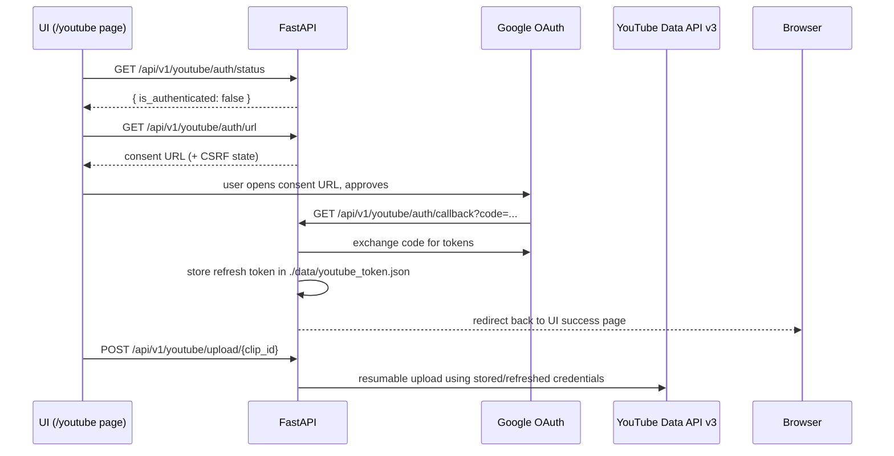

# 🎫 YouTube Authentication (OAuth 2.0)

Publishing to YouTube requires a Google OAuth link performed once per installation. It is implemented by `YouTubeUploaderService` in [`app/services/youtube_uploader.py`](../app/services/youtube_uploader.py) and exposed under `/api/v1/youtube/auth/*`.

---

## 1. Prerequisites

1. A Google Cloud project with the **YouTube Data API v3** enabled.
2. OAuth client credentials (`client_secrets.json`) — user-provided, stored at `./data/client_secrets.json` (see [SECURITY.md](../SECURITY.md) for storage rules).
3. `YOUTUBE_REDIRECT_URI` (default `http://localhost:3001/api/v1/youtube/auth/callback`) must exactly match the Authorized redirect URI in the Google Cloud console.

Optionally, credentials can be delivered inline via `YOUTUBE_CLIENT_ID` / `YOUTUBE_CLIENT_SECRET` / `YOUTUBE_REFRESH_TOKEN` settings instead of the secrets file.

## 2. The flow

Endpoints involved (full list in [API_REFERENCE.md](../API_REFERENCE.md)):

| Endpoint | Purpose |
|---|---|
| `GET /auth/status` | Whether a valid token exists (`is_authenticated`) |
| `GET /auth/url` | Generates the consent URL |
| `GET /auth/callback` | Browser redirect handler — exchanges the code *(no envelope; returns a redirect HTML page)* |
| `POST /auth/callback` | Manual code exchange for non-browser flows |
| `POST /auth/credentials` | Submit/upload `client_secrets.json` content |
| `POST /auth/revoke` | Revoke the grant with Google and delete the local token file |

## 3. Token storage & lifecycle

- Tokens persist in `./data/youtube_token.json`; the uploader refreshes transparently on expiry.
- `POST /auth/revoke` is the supported removal path — file deletion alone does not revoke the grant server-side.
- No token ever appears in logs; correlation IDs stay unrelated to credentials.

## 4. Scopes & minimality

The uploader registers only the scopes needed for publishing (narrow by default; widen deliberately if a new integration needs more, and document the change here and in Google Cloud).

## 5. Common issues

| Symptom | Fix |
|---|---|
| `401` on upload endpoints | Not linked yet — run the consent flow first |
| `redirect_uri_mismatch` from Google | `YOUTUBE_REDIRECT_URI` differs from the console entry |
| Refresh loop failing | Revoke and re-consent (refresh token expired/rotated) |
| Multi-install conflicts (same Google account) | Google allows multiple grants; re-consenting doesn't break other apps |
