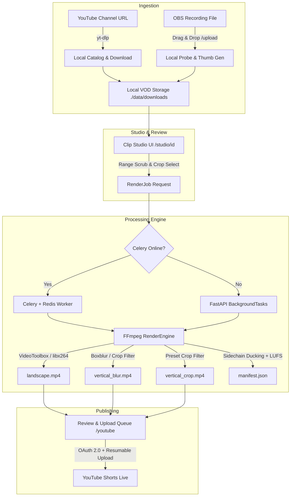
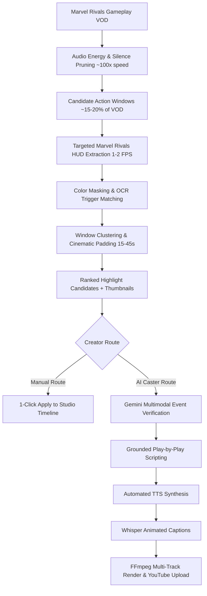

# 🎙️ BackseatCaster (`backseat-ai`)

> Turn silent gameplay recordings into AI-narrated, high-impact gaming clips and YouTube Shorts.

[](https://opensource.org/licenses/MIT)
[](https://www.python.org/downloads/)
[](https://nextjs.org/)
[]()
[](https://ffmpeg.org/)

---

## 1. Project Overview & Current State

BackseatCaster is a **local-first AI video editing and publishing pipeline** designed to transform raw gameplay footage (VODs) into punchy, high-engagement YouTube Shorts and gaming clips.

### Current Product Reality
The foundational manual editing, rendering, and publishing stack is **100% built, tested, and operational**:
- **Local Rendering Engine:** Apple Silicon `h264_videotoolbox` / `libx264` rendering to 16:9 Landscape Master and 9:16 Vertical formats (Full Blur, Third-Person Wide Crop, Direct Center Crop) with Lanczos scaling.
- **Audio Pipeline:** Sidechain compression mixing voiceover narration with ducked gameplay audio, peak limiting, and EBU R128 (-14 LUFS) loudness normalization.
- **Web Studio & Review UI:** Next.js 16 interface with timeline video player, dual-handle range scrubbing, crop guide overlays, live comparison tabs, and job status polling.
- **Ingestion Suite:** Dual-mode ingestion via YouTube `yt-dlp` channel scraping & download, plus drag-and-drop OBS local video upload with instant probing & thumbnail generation.
- **YouTube Ingestion & Publishing:** Google OAuth 2.0 authentication, upload staging queue, and direct resumable publishing to YouTube Shorts via YouTube Data API v3.
- **Background Worker Engine:** Celery + Redis with automatic fallback to FastAPI `BackgroundTasks`.

---

## 2. Product Roadmap & Status

| Phase | Deliverable | Status |
|---|---|---|
| **Phase 1** | **Local Video Rendering Engine:** 16:9 master, 9:16 blur & crop presets, audio ducking, CLI, API, probe & validation suite | **Completed** |
| **Phase 6** | **Creator Studio & Review Interface:** Web studio (`/studio/[id]`), timeline scrubbing, crop overlays, comparison player, render catalog (`/renders`), bulk delete | **Completed** |
| **Phase 7** | **YouTube Ingestion & Publishing:** Channel scraping & VOD download via `yt-dlp`, OAuth 2.0 flow, upload queue (`/youtube`), resumable YouTube Shorts publishing | **Completed** |
| **Infra** | **Async Worker System:** Celery + Redis with zero-config fallback to FastAPI `BackgroundTasks`, retry mechanics | **Completed** |
| **Phase 2 (Ingest)** | **Local File / OBS Recording Import:** Direct upload endpoint (`/api/v1/videos/upload`), drag-and-drop dropzone with progress bar, probe & thumbnail generation | **Completed** |
| **Shorts+** | **Audio Loudness Normalization:** FFmpeg EBU R128 (`loudnorm`) targeting -14 LUFS for YouTube Shorts standards, dual-chain support | **Completed** |
| **Phase 2 (Mining)** | **Marvel Rivals Candidate Highlight Mining:** Audio energy scanning, targeted HUD OCR/color detection, window clustering, candidate scoring API & UI drawer | **Completed** |
| **Phase 2.5 (Accuracy & Perf)** | **Anti-False-Positive Hardening & Speed Optimization:** Upper-banner ROI alignment, color gating tightening (8x faster Stage 3), adaptive sampling, regex sanitization, scoreboard rejection, persistence scoring | **Completed** |
| **Phase 3** | **HUD/OCR & Deep Visual Event Extraction:** Killfeed chains, ultimate counters, character ability identification | Planned |
| **Phase 4** | **Gemini Event Verification:** Multimodal clip verification, structured event schema, grounding checks | Planned |
| **Phase 5** | **AI Commentary & TTS Generation:** Gemini casting script generation, automated TTS narration (Edge-TTS / ElevenLabs), audio sync | Planned |
| **Shorts+** | **Dynamic Animated Captions (Subtitles):** Whisper transcription, word-by-word animated/karaoke subtitles burned into 9:16 video | Planned |
| **Shorts+** | **Split-Screen Facecam + Gameplay Layout:** Custom dual-crop filter (top webcam, bottom gameplay) for streamer VODs | Planned |

---

## 3. Architecture

### Active Operational Architecture (Built)



### Planned End-to-End AI Pipeline (Mining & Caster)



---

## 4. Marvel Rivals Candidate Mining: Step-by-Step Release Plan

To build and release the candidate mining engine incrementally, the feature is split into 6 modular steps:

```
[Step 1: Audio Energy Scanner] ──> [Step 2: HUD ROI Extractor] ──> [Step 3: Color & OCR Matcher]
                                                                                │
[Step 6: Studio UI Drawer]     <── [Step 5: API & Worker]       <── [Step 4: Window Clustering]
```

---

### Step 1: Rapid Audio Excitement & Silence Scanner (`ebur128` + RMS)
- **Goal:** Scan a 1-to-3 hour VOD in under 45 seconds to locate high-energy team fights and prune lobby queues, loading screens, and respawn countdowns.
- **Implementation:**
  - Execute FFmpeg audio metadata pass: `ffmpeg -i vod.mp4 -vn -filter:a "ebur128=metadata=1" -f null -`
  - Parse Momentary Loudness (`M`) and Peak Energy into 0.5-second time buckets.
  - Calculate rolling audio excitement threshold (top 20–25th percentile).
  - Produce candidate time windows where action occurs, pruning segments with sustained low energy (< -30 LUFS).
- **Deliverables & Tasks:**
  - [x] Implement `app/services/highlight/audio_scanner.py`
  - [x] Extract volume energy timeline without decoding video stream
  - [x] Write unit tests with synthetic sine/silence audio tracks

---

### Step 2: Targeted Marvel Rivals HUD Region Extractor
- **Goal:** Avoid full-frame analysis by cropping only fixed gameplay HUD areas on candidate windows at low frequency (1–2 FPS).
- **HUD Geometry (1080p Normalized Coordinates):**
  ```
  +-------------------------------------------------------------------------+
  | [Top-Left]                       [Top-Center]               [Top-Right] |
  | Match Score / Mode         Objective / Overtime Banner       KILL FEED  |
  | (Convoy / Convergence)          Y: 30-110, X: 800-1120     Y: 40-260    |
  |                                                           X: 1400-1880  |
  |                                                                         |
  |                                  [Center]                               |
  |                             ELIMINATION / KO                            |
  |                            "TRIPLE KO / TEAM WIPE"                      |
  |                             Y: 660-840, X: 720-1200                     |
  |                                                                         |
  | [Bottom-Left]                  [Bottom-Center]            [Bottom-Right]|
  | Health Bar (HP)              ULTIMATE ABILITY METER       Weapon / Ammo |
  | Hero Portrait / Team-Up      Ready (100% glow) vs Cast    Cooldowns     |
  | Y: 900-1040, X: 60-380        Y: 880-1050, X: 880-1040                  |
  +-------------------------------------------------------------------------+
  ```
- **Implementation:**
  - Use FFmpeg pipe or OpenCV to crop 2 primary ROIs during high-energy windows:
    1. **Center KO Banner ROI:** `X: [720, 1200]`, `Y: [660, 840]` (Width 480, Height 180)
    2. **Kill Feed ROI:** `X: [1400, 1880]`, `Y: [40, 260]` (Width 480, Height 220)
- **Deliverables & Tasks:**
  - [x] Implement `app/services/highlight/roi_extractor.py`
  - [x] Support resolution scaling (auto-scale from 720p, 1440p, or 4K to 1080p base coordinates)
  - [x] Extract frames in memory without writing thousands of intermediate image files to disk

---

### Step 3: Color Masking & OCR Trigger Matching
- **Goal:** Accurately detect Marvel Rivals eliminations, multi-kills, and match outcomes with zero false positives.
- **Signal Triggers:**
  1. **Color Thresholding:**
     - Marvel Rivals uses high-contrast Gold/Yellow (`#FFD700` / HSV range `[20-35, 150-255, 180-255]`) and Red elimination accents.
     - Fast pixel count check: if matching pixel ratio > threshold, proceed to OCR; otherwise skip.
  2. **Keyword OCR Matching:**
     - Center screen keywords: `DOUBLE KO`, `TRIPLE KO`, `MEGA KO`, `ULTRA KO`, `TEAM WIPE`, `ELIMINATED`, `+100`.
     - Match banners: `VICTORY`, `ROUND WON`, `OVERTIME`.
- **Deliverables & Tasks:**
  - [x] Implement `app/services/highlight/visual_matcher.py`
  - [x] Add HSV color filter + lightweight OCR matcher (`rapidocr-onnxruntime` or `pytesseract`)
  - [x] Classify event types: `single_ko`, `double_ko`, `triple_ko`, `team_wipe`, `objective_clutch`

---

### Step 4: Window Clustering, Cinematic Padding & Scoring Engine
- **Goal:** Assemble raw timestamp detections into publish-ready 15–45 second highlight clips with proper context.
- **Logic:**
  1. **Clustering:** Merge detections occurring within 5 seconds of each other into a single chain (e.g. Kill 1 at 142s, Kill 2 at 145s, Kill 3 at 148s).
  2. **Cinematic Padding:**
     - **Pre-Roll (6–8s):** Captures the setup, flank, positioning, and ultimate startup before the first elimination.
     - **Post-Roll (3–5s):** Captures the aftermath, emote, or team wipe banner.
  3. **Duration Constraints:** Clamp target duration between 18.0s and 45.0s (the optimal YouTube Shorts retention window).
  4. **Scoring Hierarchy:**
     - `team_wipe` (Quad/Penta/Hexa KO): **1.00**
     - `triple_ko`: **0.85**
     - `double_ko`: **0.70**
     - `objective_clutch` / Overtime Victory: **0.75**
     - `single_ko` with Ultimate: **0.55**
- **Deliverables & Tasks:**
  - [x] Implement `app/services/highlight/cluster_engine.py`
  - [x] Generate candidate preview thumbnail at peak action timestamp
  - [x] Auto-generate catchy Short titles (e.g., *"Star-Lord Triple KO in Overtime! 🔥 #MarvelRivals"*)

---

### Step 5: Data Models, API Endpoints & Background Worker
- **Goal:** Expose async candidate detection to the frontend with real-time progress tracking.
- **Database Model & Schema:**
  - Model `HighlightCandidate` in SQLAlchemy (`video_id`, `start_seconds`, `end_seconds`, `duration`, `score`, `event_type`, `details_json`, `thumbnail_url`).
- **REST Endpoints:**
  - `POST /api/v1/videos/{video_id}/highlights/detect` (trigger scan in background worker)
  - `GET /api/v1/videos/{video_id}/highlights/status` (polling: progress %, current stage)
  - `GET /api/v1/videos/{video_id}/highlights` (retrieve ranked candidates list)
  - `DELETE /api/v1/videos/{video_id}/highlights` (clear candidates)
- **Deliverables & Tasks:**
  - [x] Add `HighlightCandidate` ORM model & Alembic migration
  - [x] Create router `app/routers/highlights.py`
  - [x] Implement background worker task (`detect_highlights_task` with Celery + BackgroundTasks fallback)
  - [x] Write automated pytest suite in `tests/test_highlight_api.py`

---

### Step 6: Clip Studio UI Integration
- **Goal:** Give creators a seamless 1-click experience in the Next.js web application.
- **UI Components:**
  - **"Find AI Highlights" Button:** On the Studio page (`/studio/[id]`) and Video Detail page.
  - **Progress Banner:** Displays live analysis status (*"Scanning audio energy... 45%"* -> *"Analyzing Marvel Rivals HUD... 80%"*).
  - **Highlights Drawer (`HighlightCandidatesBar.tsx`):**
    - Cards displaying event badges: `TRIPLE KO`, `TEAM WIPE`, `OVERTIME VICTORY`.
    - Thumbnail preview, score indicator, and timestamp chip (`02:14 - 02:42`).
    - **1-Click "Apply to Studio":** Instantly sets video player start time, duration, and crop preset.
    - **1-Click "Quick Render":** Triggers landscape or 9:16 Shorts rendering immediately.
- **Deliverables & Tasks:**
  - [x] Build `ui/src/components/HighlightCandidatesDrawer.tsx`
  - [x] Update `/studio/[id]` to integrate candidate selection into the dual-handle range slider
  - [x] Add API methods to `ui/src/lib/api.ts`

---

### Phase 2.5: Detection Accuracy, Speed Optimization & Anti-False-Positive Hardening
- **Goal:** Eliminate false positive `team_wipe` candidates caused by scoreboard overlays, weapon HUD noise, and over-broad keyword matching, while speeding up Stage 3 by 70–85% through tighter color gating and adaptive sampling.
- **Root Cause Discoveries from Real VOD Mining (`3xvvWjxscRA` & `3YPlVGicZYU`):**
  1. **Tab Scoreboard Infiltration via Center Column Icon:** RapidOCR extracted a 28x28 icon in the center column of the Tab scoreboard as `"ACE"` (conf 0.90–0.99), causing 11 false-positive `team_wipe` candidates with 1.0 score.
  2. **Primary Banner ROI Misalignment:** Marvel Rivals renders main streak and elimination banners (`5 PLAYER KO STREAK!`, `TRIPLE KO`, `TEAM WIPE`) in the **upper-center** ($y=240..350, x=720..1200$), whereas `center_ko` was configured at $y=570..730$ directly over the weapon reticle, subtitles, and vehicle prompts (`Launch Missiles / Halt`).
  3. **Overly Permissive Color Gating:** `min_gold_ratio = 0.001` (only 76 pixels in a 480x160 box) caused 3,758 frames to invoke RapidOCR, ballooning Stage 3 duration to 522.5s (~8.7 minutes). Real banners contain 1,000–3,000 gold/red pixels ($0.006–0.020$ ratio).
  4. **Unleveraged Audio Headroom:** Audio scanning on 58 minutes of video takes only 12.35s. With Stage 3 sped up 8x, `excitement_percentile` can safely be lowered from 75.0 to 68.0 to capture quiet build-ups and flank eliminations without noticeable overhead.
  5. **Flat vs Adaptive Frame Sampling:** Sampling flat 1.5 FPS produces redundant frames during quiet periods. A 0.75 FPS baseline with 2.0 FPS bursts around audio peaks ($\pm 3\text{s}$) cuts frame counts by ~60% while improving precision during fight climaxes.
  6. **Kill Feed Multi-Kill Tracking:** Real multi-kills by the player (e.g., `Havefunplaying` quad-kill at 1410s, triple-kill at 2174s and 2924s) appear reliably in the top-right kill feed (`x=1400..1880, y=40..220`).
- **Deliverables & Tasks:**
  - [x] **Task 1: Tighten Color Gating (Stage 3 Speedup):** Increase `min_gold_ratio` and `min_red_ratio` from 0.001 to 0.006 (~460 pixels). Prunes non-event frames before OCR, cutting RapidOCR calls.
  - [x] **Task 2: Correct Announcement Banner ROI Geometry:** Re-anchor the primary announcement ROI (`center_ko` / `upper_banner`) to $y=230..370, x=700..1220$ (1080p base) to directly capture `'5 PLAYER KO STREAK!'`, `'TEAM WIPE!'`, and `'TRIPLE KO!'` while bypassing reticle crosshairs and subtitles.
  - [x] **Task 3: Scoreboard & Menu Negative Filtering:** Add immediate rejection for frames containing Tab scoreboard or summary text: `DAMAGE BLOCKED`, `HEALING`, `CAREER STATS`, `YOUR TEAM`, `ENEMY TEAM`, `SCOREBOARD`, `PRESS TAB`, `RESPAWNING IN`, `MATCH SUMMARY`.
  - [x] **Task 4: Strict In-Game Regex Sanitization:** Remove `ACE` and `6 KO`. Require strict multi-word boundary matching (`TEAM WIPE`, `TRIPLE KO`, `DOUBLE KO`, `MEGA KO`, `ULTRA KO`, `HEXA KO`, `PLAYER KO STREAK`, `SHUTDOWN`).
  - [x] **Task 5: Typography & Bounding Box Geometry Gating:** Enforce banner text bounding box height $\ge 22\text{px}$ and width $\ge 90\text{px}$, filtering out small ammo numbers, KDA counters, and chat text.
  - [x] **Task 6: Adaptive Frame Sampling & Audio Window Broadening:** Implement 0.75 FPS baseline sampling across candidate windows with 2.0 FPS bursts around audio energy peaks ($\pm 3\text{s}$). In `AudioScannerConfig`, lower `excitement_percentile` to 68.0 and increase `merge_gap_seconds` to 3.5s to capture pre-fight build-up.
  - [x] **Task 7: Multi-Frame Temporal Persistence & Dynamic Composite Scoring:** Require candidate elimination banners to appear across $\ge 2$ sampled frames or possess chained multi-kill progression. Replace static 1.0 scoring with a dynamic weighted formula:
    $$\text{Score} = (0.45 \times \text{TierWeight}) + (0.25 \times \text{PersistenceFactor}) + (0.15 \times \text{OCRConf}) + (0.15 \times \text{AudioEnergy})$$
  - [x] **Task 8: Re-Scan Validation on Real VODs:** Re-run detection on `3YPlVGicZYU` and `3xvvWjxscRA`. Verified zero false-positive team wipes (down from 11), genuine 5-player kill streaks surfaced at the top with composite scores 0.76–0.91, and all 150 tests passing.

---

## 5. Candidate Schema Definition

Each mined highlight is represented by the following standardized JSON contract:

```json
{
  "candidate_id": "cand_mvr_91a2b",
  "video_id": "obs_67a12b89",
  "start_seconds": 118.0,
  "end_seconds": 146.0,
  "duration_seconds": 28.0,
  "score": 0.94,
  "event_type": "triple_ko",
  "game": "Marvel Rivals",
  "details": {
    "kill_count": 3,
    "has_ultimate": true,
    "is_team_wipe": false,
    "game_phase": "overtime",
    "trigger_events": [
      {"time": 124.0, "label": "Elimination"},
      {"time": 128.5, "label": "DOUBLE KO"},
      {"time": 131.2, "label": "TRIPLE KO"}
    ]
  },
  "thumbnail_url": "/api/v1/videos/obs_67a12b89/highlights/cand_mvr_91a2b/thumb.jpg",
  "suggested_title": "Clean Triple KO in Overtime! 🔥 #MarvelRivals",
  "suggested_tags": ["MarvelRivals", "Gaming", "Shorts", "TripleKO", "Gameplay"]
}
```

---

## 6. Privacy, Cost, and Reliability Principles

1. **Local-First Default:** Audio scanning, HUD cropping, and candidate mining run 100% locally on your machine.
2. **Selective Cloud Usage:** Only validated candidate clips (not entire multi-hour VODs) are ever sent to Gemini for commentary scripting.
3. **Deterministic Testing:** Use synthetic FFmpeg test assets (`testsrc`, `sine`, `drawtext`) to test detection algorithms without requiring multi-gigabyte VOD downloads.
4. **Creator Control:** Automated candidates are recommendations; human review and approval in Clip Studio remain mandatory before rendering or publishing.
